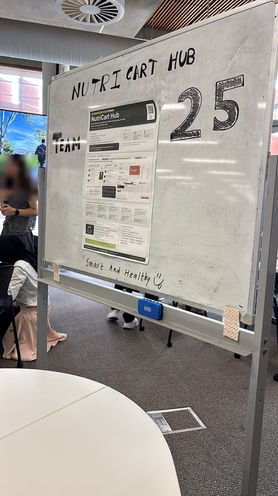

# Tradeshow feedback (Week 12, 20 and 22 Oct)

**What:** visitors used the physical Home Dock and two Cart Units (app-v2) in pairs at our stall. Other teams left structured feedback cards on the course Miro board, one card for each of six questions.
**Source:** "Given by Team NN" rows in the Team 25 inbox, from Teams 16, 17, 18, 20 and 24. Reviewer names are left out; quotes are cited by team.
**Used in:** [Design Process Overview §7](https://github.com/Anujithaaa/DECO3500-Team25-NutriCart/wiki/Design-Process-Overview) and [Ethical Considerations](https://github.com/Anujithaaa/DECO3500-Team25-NutriCart/wiki/Ethical-Considerations) (E1, E3, E5, E11).

## What worked

| Theme | Evidence |
|---|---|
| Two places, one household | "It splits the experience across two distinct physical environments, one being the kitchen and another being the supermarket" (T18). The valued connection is "grocery planning at home with the actual shopping experience" (T16). |
| Real-time sync | "The kitchen tablet and phone synced properly, so the main shared list worked" (T24). The live shared list showed how housemates could coordinate across devices (T17). |
| Simulation | "The prototype was meant to be a separate device and not an app, and that was very well simulated" (T18). |
| Research → design | The research-to-design strip on the poster was "very strong, because each quote links to a design choice" (T18). Peers named the 7 interviews and 13 prototype sessions, and that the group chat is our competitor (T17). |
| Relatable problem | "Practical and easy to relate to because grocery planning and budgeting are common household activities" (T16). |

## What needs work

| Theme | Evidence | Matches | Next |
|---|---|---|---|
| First use | A step-by-step tutorial for first-time users (T18); a short guide at the start (T17); easier navigation for first-time users (T18) | F2 | First-use walkthrough |
| Unclear labels | Numbers in the meal editor had no unit or heading (T24, T17); clear price labels and servings (T24) | – | Label every value |
| Not yet working | The deals tab was not functional (T24); barcode scanning was not fully usable (T17); the split feature lacked implementation (T18) | – | Finish compare and scanning |
| Group chat | "Instead of replacing group chats, integrate with it?" (T18) | F3 | Share to the group chat |
| Is it social? | "It actually makes housemates interact less, because you don't need to ask anyone anything" (T24); most share-housers cook their own food, so focus on the shared list and who spent what, like Splitwise (T24) | F4 | Lead with the live in-store moment and the cost split |
| Pitch and poster | The poster is "a bit crowded" and text-heavy (T18, T24); show more clearly how the two devices communicate (T16); "it took me and my group mates a while to figure out what the device even does" (T18) | – | One-line purpose first |
| Extra device | Carrying an extra device is less practical than a phone; people may shop on the way home from uni (T20) | – | Cart Unit on any phone (already in v0.3) |

## Ethics raised by peers

- **Money visibility (E1):** showing the budget and who owes what "might be a bit embarrassing for people who are tighter on money, and guests could see it too" (T18). Seeing who spends what "could cause arguments or feel like judgement" (T24). The system should not make "someone feel uncomfortable about how much money they contribute" (T16).
- **Personal data (E3):** shopping habits, dietary preferences and spending details are sensitive, and users should control what is shared (T16, T17, T20). One team noted we already show "shopping activity without tracking users' locations" (T20).
- **Participation (E5):** a housemate who doesn't want to interact with the Hub (T18); one person always paying and not getting the money back (T24).

## Challenging scenarios

- Poor reception in the supermarket, so the shopper misses an update and buys something twice (T16, E11).
- Limited kitchen space, few power outlets or unreliable Wi-Fi for the Dock (T20).
- Housemates with different diets who can't agree on a shared meal (T17, T20, T24).

## How to strengthen research → design (peer suggestions)

- Show how many participants raised each issue, not just one quote (T20).
- Explain how each testing session changed the design (T18, T17).
- Compare NutriCart with a normal shopping list on the same tasks (T16).
- Test in a real supermarket, and with more than four students (T18, T24).
