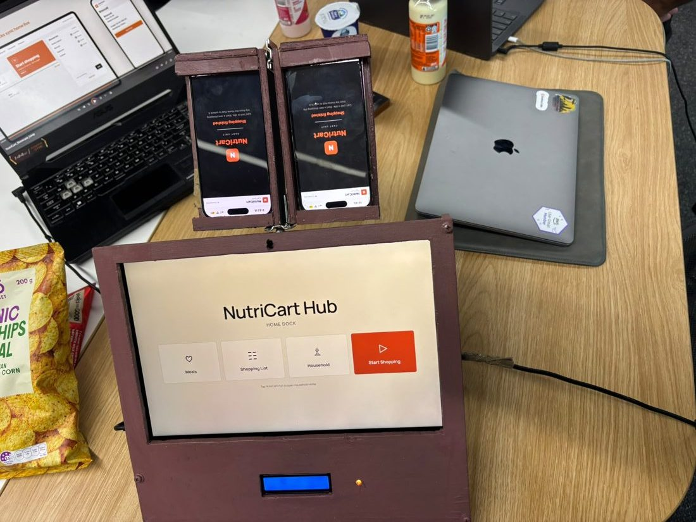
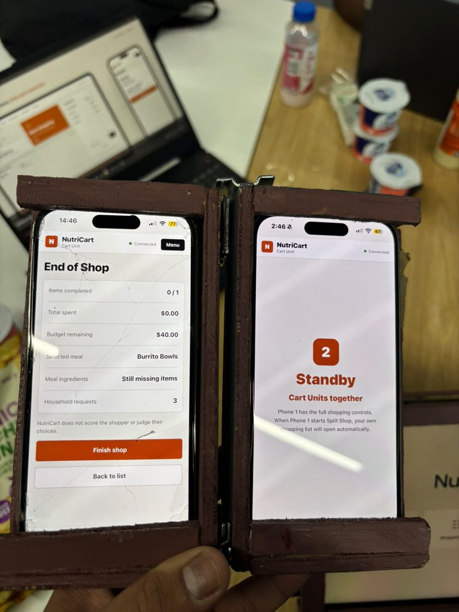
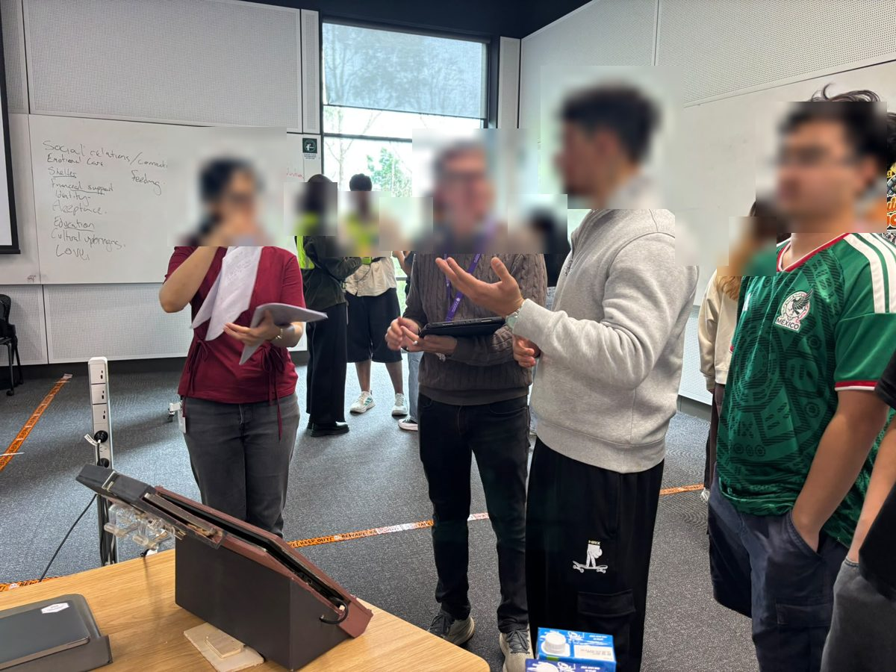

# Design Process Overview

**Poster:** [PDF](https://github.com/Anujithaaa/DECO3500-Team25-NutriCart/blob/main/documents/promo/NutriCart_Poster_A2.pdf) · **Promotional material:** [pitch script](https://github.com/Anujithaaa/DECO3500-Team25-NutriCart/blob/main/documents/promo/pitch-script.md) · **Prototype:** runs on a laptop and phones, no login; run steps for app-v2 and v0.3 are in the [README](https://github.com/Anujithaaa/DECO3500-Team25-NutriCart). · **Team 25:** Aman Kushwaha, James Olbes, Anujitha Fernando, Kenan Chu

## Summary

We investigated how students in share houses near UQ St Lucia plan and coordinate groceries. Price decides most purchases, and “healthy” means something different to everyone. Most shopped alone, yet shopping overlapped through shared staples, fridge space and lists sent to whoever was going. The useful social influence isn’t a feed of friends’ meals but household coordination: who needs what, who’s going, what’s in the fridge, and who pays.

NutriCart Hub is our response. Housemates plan together at the kitchen Home Dock, and whoever shops takes the Cart Unit with the household's list, requests and budget. The social computing sits in six moments where several housemates take part (G1–G6).

## Process

### 1. Understanding the domain (Weeks 3–6)
Our first domain statement was about "enhancing healthy food choices". Round 1 interviews showed **price first** ("99 out of 100 times") and social influence through **trust and timing**: a housemate who finds the cheap milk. Food-choice tools are mostly individual (Marshall et al., 2022), and social media inspiration rarely carries into the store (Wang et al., 2024). Proposal feedback asked: whose definition of healthy? Why an app?

*Four versions of our domain statement, from "healthy choices" to household coordination.*

### 2. An app as a probe, not a product (Weeks 6–7)
**v1**, a social shopping app with friend recommendations, group goals and recipes, was a **design probe**. People wanted **prices**, not friends' recipes, and one read a healthy-dinner goal as "essentially telling me that I'm fat".

### 3. Reframing and divergence (Weeks 7–8)
Synthesis reframed the problem: *support real grocery decisions without adding effort, judgement or another app.* Non-app concepts (a budget buzzer, a "grocery baton") combined into **v2**: a cardboard Home Dock and detachable Cart Unit, tested with Wizard of Oz. Testing kept the **shared list, running budget and neutral compare**, and told us to keep alerts rare ("noise, not help") and cut data entry. Our four requirements: inform without judging, price first, no extra effort, and support coordination the household already does.

*Storyboard: with the Hub, the household's needs travel with the shopper. More concepts in [documents/design](https://github.com/Anujithaaa/DECO3500-Team25-NutriCart/tree/main/documents/design).*

### 4. "What's the point of the social part?" (Week 9 Stand-up)
Staff said the social aspect was weak, so we redesigned around **six group moments** on the time–space matrix:

| | Same time | Different time |
|---|---|---|
| **Same place** | G1 plan together at the Dock · G5 Split Shop in store | G2 leave a request · G3 hand over the baton · G6 return and settle |
| **Different place** | G4 one quick question home | – |

The Hub now **facilitates** coordination households already do (Olsson et al., 2020), uses visible traces rather than notifications (Schmidt, 2002) and gives every housemate something back (Grudin, 1994).

The Designing for Location Dependence framework (Design for Location, n.d.) showed that decisions start at home, so NutriCart follows a home → store → home trajectory: the Dock belongs to the kitchen; the Cart Unit shows only what matters in store.

### 5. v3: multi-user and live, going physical (Weeks 10–11)
v3 is an **integration prototype** (Houde & Hill, 1997), real where the social experience depends on it. James built a live-sync backend and an Expo Cart Unit with **barcode scanning**; v0.3 added requests, "Jay is shopping now", Ask home, two-phone Split Shop and a cost split. Prices are entered by hand, and compare orders products by **the shopper's** priority, never "healthier".

*v3 Home Dock during a live shop.*

*v3 Cart Units: Split Shop, Ask home, compare and the return summary.*

James built physical housings; Kenan's **app-v2** redesigned the Hub and Cart Unit, the version we tested and showed at the tradeshow.

*Home Dock housing with two Cart Unit mounts.*

*Split Shop on two Cart Units.*

### 6. Evaluating with groups, in context (Week 12)
Two group sessions with four students who live together, one in their own kitchen ([Evaluation Plan](https://github.com/Anujithaaa/DECO3500-Team25-NutriCart/wiki/Evaluation-Plan)). All four valued the budget, Compare or deals most; all struggled with first use. The sharpest finding: **the group chat is our real competitor**. G-01 called requests "another group chat", while G-02 valued seeing what was already at home. The social value sat in the live, in-store moment, so we will lead with same-time coordination, work alongside the chat, simplify first use, and swap the LEDs for a chime.

### 7. Tradeshow (Week 12)

*Visitors at our stall (faces blurred).*

Visitors used the Dock and two Cart Units in pairs, and five teams left feedback on Miro ([summary](https://github.com/Anujithaaa/DECO3500-Team25-NutriCart/blob/main/documents/evaluation/tradeshow-feedback.md)). They confirmed the two-place design ("it splits the experience across two distinct physical environments", Team 18). Three problems repeated:

- **First use** is hard: three teams asked for a guide (F2).
- **Unlabelled numbers**, and deals and scanning not fully working.
- **The group chat**: "instead of replacing group chats, integrate with it" (Team 18; F3).

**Next:** a first-use walkthrough, clear labels, working compare, sharing to the chat, and a private cost split (Ethics E1). James's [iteration evaluation](https://github.com/Anujithaaa/DECO3500-Team25-NutriCart/blob/main/documents/evaluation/current-iteration-evaluation.md) sets out the next test.

### Limitations
Samples were small and mostly people we could reach, and we consulted no domain expert (e.g. student-housing staff); studio critique stood in. Final testing (two short group sessions and tradeshow peers) shows first use, not how a household behaves over weeks (Grudin, 1994). v2 was Wizard of Oz, and v3 supports one household per server.

## Who did what

| Member | Main contributions |
|---|---|
| Aman Kushwaha (Project Management Lead) | Plan, charter, task board, stand-ups; synthesis; de-identification; evaluation plan; pitch and tradeshow pack |
| James Olbes (Design & Prototyping Lead) | Shadowing; physical prototypes (v2, v3 housings); backend and Expo Cart Unit; iteration evaluation |
| Anujitha Fernando (Technical & Dev Lead) | GitHub repo set-up; integration and multi-device testing of v3; poster layout and printing |
| Kenan Chu (Documentation & Theory Lead) | Physical prototypes; interview synthesis; personas and scenarios; research archive and README; app-v2 redesign and frontend; WIKI and final PDF |

We shared 23 research and testing sessions; the [evidence register](https://github.com/Anujithaaa/DECO3500-Team25-NutriCart/wiki/User-Research#6-evidence-register) shows who ran each.

**Use of AI:** every member used Claude and ChatGPT; see the [README](https://github.com/Anujithaaa/DECO3500-Team25-NutriCart#use-of-ai).

## References

- Design for Location. (n.d.). *Designing for location dependence: A framework*. https://designforlocation.org/framework.html
- Grudin, J. (1994). Groupware and social dynamics: Eight challenges for developers. *Communications of the ACM, 37*(1), 92–105.
- Houde, S., & Hill, C. (1997). What do prototypes prototype? In M. Helander, T. Landauer & P. Prabhu (Eds.), *Handbook of Human-Computer Interaction* (2nd ed., pp. 367–381). Elsevier.
- Marshall, J., Jimenez-Pazmino, P., Metoyer, R., & Chawla, N. V. (2022). A survey on healthy food decision influences through technological innovations. *ACM Transactions on Computing for Healthcare, 3*(2), Article 25. https://doi.org/10.1145/3494580
- Olsson, T., Jarusriboonchai, P., Woźniak, P., Paasovaara, S., Väänänen, K., & Lucero, A. (2020). Technologies for enhancing collocated social interaction: Review of design solutions and approaches. *Computer Supported Cooperative Work, 29*, 29–83.
- Schmidt, K. (2002). The problem with "awareness". *Computer Supported Cooperative Work, 11*(3–4), 285–298.
- Wang, C.-H. A., Sher, S. T.-H., & Chung, C.-F. (2024). From viral content to real-life cuisine and beyond: Examining teenagers' interactions with TikTok food videos and the influence on their food practices. *Proceedings of the ACM on Human-Computer Interaction, 8*(CSCW2), Article 389. https://doi.org/10.1145/3686928
