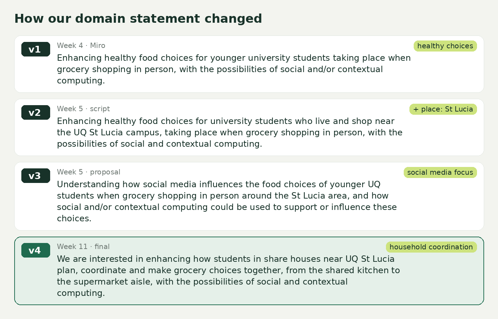
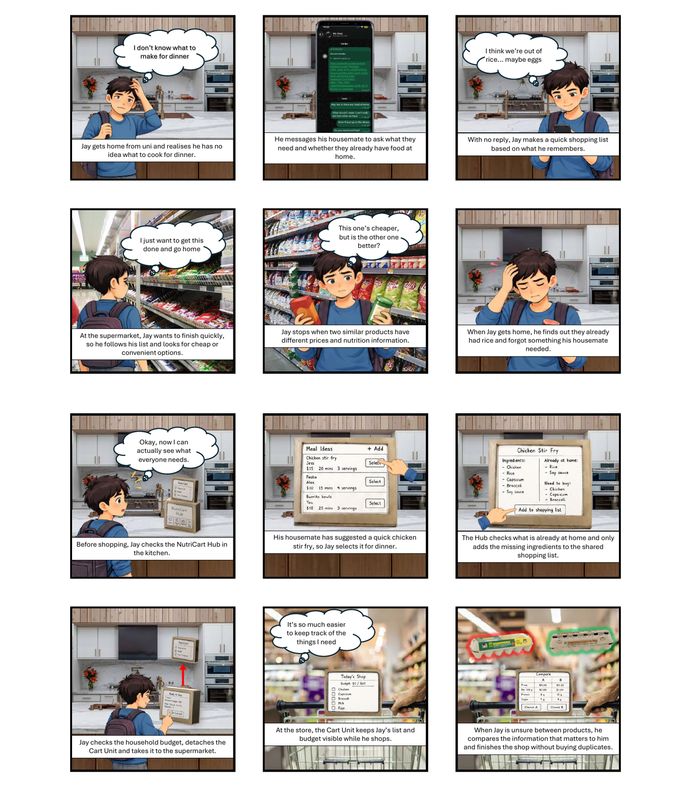
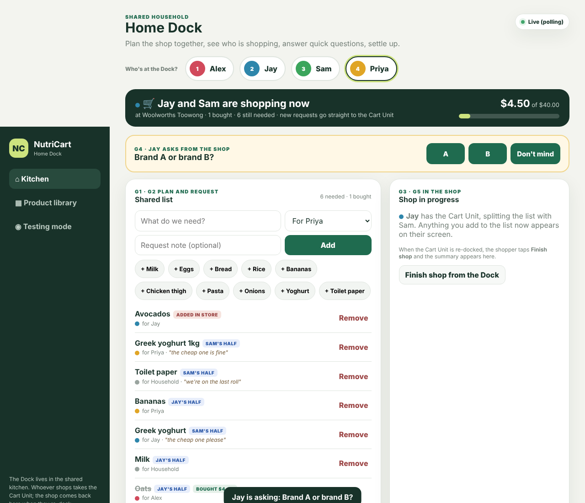
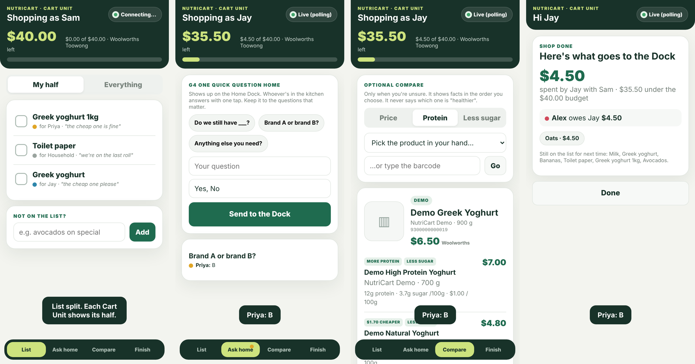

# Design Process Overview

**Poster:** [PDF](https://github.com/Anujithaaa/DECO3500-Team25-NutriCart/blob/main/documents/promo/NutriCart_Poster_A2.pdf) · **Promotional material:** [pitch script](https://github.com/Anujithaaa/DECO3500-Team25-NutriCart/blob/main/documents/promo/pitch-script.md) · **Prototype:** runs on a laptop and phones, no login; run steps for app-v2 and v0.3 are in the [README](https://github.com/Anujithaaa/DECO3500-Team25-NutriCart). · **Team 25:** Aman Kushwaha, James Olbes, Anujitha Fernando, Kenan Chu

## Summary

We investigated how students living together near UQ St Lucia plan, coordinate and make grocery decisions. Price decides most purchases, and “healthy” means something different to everyone. Most shopped alone, yet their shopping overlapped through shared staples, fridge space and lists sent to whoever was going. The useful social influence isn’t a feed of friends’ meals but the everyday coordination of a household: who needs what, who’s going, what’s already in the fridge, and who pays.

NutriCart Hub is our response. Housemates plan together at the kitchen Home Dock, and whoever shops takes the Cart Unit with the household's list, requests and budget. The social computing sits in six moments where several housemates take part (G1–G6).

## Process

### 1. Understanding the domain (Weeks 3–6)
Our first domain statement was about "enhancing healthy food choices". Round 1 interviews asked for **stories** not opinions, and showed **price first** ("99 out of 100 times") and social influence that works through **trust and timing**: a housemate who finds the cheap milk, a reel seen right before going out. The literature showed food-choice tools are mostly individual (Marshall et al., 2022), and that social media inspiration rarely carries into the store (Wang et al., 2024). Proposal feedback asked: whose definition of healthy? Why an app?

*Our domain statement went through four versions, from "healthy choices" and "social media" to household coordination.*

### 2. An app as a probe, not a product (Weeks 6–7)
**v1** was a social shopping app with friend recommendations, group goals, recipes and a checklist. We used it as a **design probe**. People wanted **prices**, not friends' recipes. Group goals divided them: one participant worried about shared goals for someone "getting less pay", and another read a healthy-dinner goal as "essentially telling me that I'm fat". One asked why they'd use another app when the supermarket already has one. 

### 3. Reframing and divergence (Weeks 7–8)
Thematic synthesis reframed the problem: *support real grocery decisions around price, time, personal priorities and household needs, without adding effort, judgement or another app.* We explored non-app concepts (a budget buzzer, a "shopping traffic light", a fridge-to-trolley "grocery baton") and combined the strongest into **v2**: a cardboard Home Dock and detachable Cart Unit, tested using Wizard of Oz. Testing kept the **shared list, running budget and neutral compare**, and told us to shrink the Cart Unit, keep alerts rare ("noise, not help") and cut data entry ("will be a pain"). This gave us four requirements: inform without judging, put price first, add no extra effort, and support coordination the household already does.

*Storyboard: Jay forgets what's at home and buys doubles; with the Hub, the household's needs travel with him. More concepts and mock-ups are in [documents/design](https://github.com/Anujithaaa/DECO3500-Team25-NutriCart/tree/main/documents/design).*

### 4. "What's the point of the social part?" (Week 9 Stand-up)
Staff said the social aspect was weak: apps are individual by nature, so we redesigned around **six group moments** and placed them on the time–space matrix:

| | Same time | Different time |
|---|---|---|
| **Same place** | G1 plan together at the Dock · G5 Split Shop in store | G2 leave a request · G3 hand over the baton (then travels with the shopper) · G6 return and settle |
| **Different place** | G4 one quick question home | – |

The Hub now **facilitates** coordination households already do (Olsson et al., 2020), uses visible traces rather than notifications (Schmidt, 2002) and gives every housemate something back (Grudin, 1994).

Applying the Designing for Location Dependence framework (Design for Location, n.d.) showed that decisions start at home, not at the store entrance, so NutriCart follows a home → store → home trajectory: the Dock belongs to the kitchen; the Cart Unit shows only what matters in store.

### 5. v3: multi-user and live, going physical (Weeks 10–11)
v3 is an **integration prototype** (Houde & Hill, 1997): it is real where the social experience depends on it. James built a live-sync backend and an Expo Cart Unit with **barcode scanning**; v0.3 added the household layer: tokens, requests, "Jay is shopping now", Ask home, two-phone Split Shop, a meal board and a cost split. Prices are entered by hand, and compare orders products by **the shopper's** priority, never "healthier".

*v3 Home Dock during a live shop, with a question from the store waiting.*

*v3 Cart Units: Split Shop ("My half"), Ask home, neutral compare and the return summary.*

James built physical housings for the Dock and the Cart Unit. Kenan's **app-v2** then redesigned the Hub and the Expo Cart Unit to match our combined concept; this is the version we tested in section 6.

### 6. Evaluating with groups, in context (Week 12)
We ran two group sessions with four students who live together, one in their own kitchen ([Evaluation Plan](https://github.com/Anujithaaa/DECO3500-Team25-NutriCart/wiki/Evaluation-Plan)). All four valued the budget, Compare or deals most, and all struggled with first-time navigation. The sharpest finding: **the group chat is our real competitor**. G-01 called requests "another group chat" and felt the design was "promoting the opposite of being social", while G-02 valued seeing what was already at home. The social value sat in the live, in-store moment. So we will lead with same-time coordination (who's shopping, Ask home, live updates), work alongside the chat, simplify first use, and swap the LEDs for a chime.

### 7. Tradeshow (Week 12)
The tradeshow (20 and 22 Oct) is our second round of testing: visitors try the flow in pairs while we note what they use, ignore and question. Findings follow after Thursday.

### Limitations
Our samples were small, qualitative and mostly people we could reach, and we did not consult a domain expert such as a dietitian or student-housing staff; studio critique stood in. Early questions were sometimes framed as "healthier vs cheaper". Final testing was two 10–15 minute group sessions with four participants, so it shows first use, not how a household behaves over weeks (Grudin, 1994); one session was screens only. v2 was Wizard of Oz, and v3 supports one household per server.

## Who did what

| Member | Main contributions |
|---|---|
| Aman Kushwaha (Project Management Lead) | Plan, charter, task board and stand-up records; synthesis; repo de-identification; evaluation plan and session G-02; pitch and tradeshow pack |
| James Olbes (Design & Prototyping Lead) | Shadowing session; physical prototypes (v2 cardboard, v3 housings); backend and Expo Cart Unit (v0.1–v0.2) |
| Anujitha Fernando (Technical & Dev Lead) | GitHub repo set-up; integration and multi-device testing of v3; poster layout and printing |
| Kenan Chu (Documentation & Theory Lead) | Physical prototypes; interview protocol synthesis; personas and scenarios; research archive and README; app-v2 redesign (Hub + Expo Cart Unit); session G-01; WIKI and final PDF |

We shared 23 research and testing sessions; the [evidence register](https://github.com/Anujithaaa/DECO3500-Team25-NutriCart/wiki/User-Research#6-evidence-register) shows who ran each.

**Use of AI:** every member used Claude and ChatGPT; see the [README](https://github.com/Anujithaaa/DECO3500-Team25-NutriCart#use-of-ai) for how, and how we checked the output.

## References

- Design for Location. (n.d.). *Designing for location dependence: A framework*. https://designforlocation.org/framework.html
- Grudin, J. (1994). Groupware and social dynamics: Eight challenges for developers. *Communications of the ACM, 37*(1), 92–105.
- Houde, S., & Hill, C. (1997). What do prototypes prototype? In M. Helander, T. Landauer & P. Prabhu (Eds.), *Handbook of Human-Computer Interaction* (2nd ed., pp. 367–381). Elsevier.
- Marshall, J., Jimenez-Pazmino, P., Metoyer, R., & Chawla, N. V. (2022). A survey on healthy food decision influences through technological innovations. *ACM Transactions on Computing for Healthcare, 3*(2), Article 25. https://doi.org/10.1145/3494580
- Olsson, T., Jarusriboonchai, P., Woźniak, P., Paasovaara, S., Väänänen, K., & Lucero, A. (2020). Technologies for enhancing collocated social interaction: Review of design solutions and approaches. *Computer Supported Cooperative Work, 29*, 29–83.
- Schmidt, K. (2002). The problem with "awareness". *Computer Supported Cooperative Work, 11*(3–4), 285–298.
- Wang, C.-H. A., Sher, S. T.-H., & Chung, C.-F. (2024). From viral content to real-life cuisine and beyond: Examining teenagers' interactions with TikTok food videos and the influence on their food practices. *Proceedings of the ACM on Human-Computer Interaction, 8*(CSCW2), Article 389. https://doi.org/10.1145/3686928
